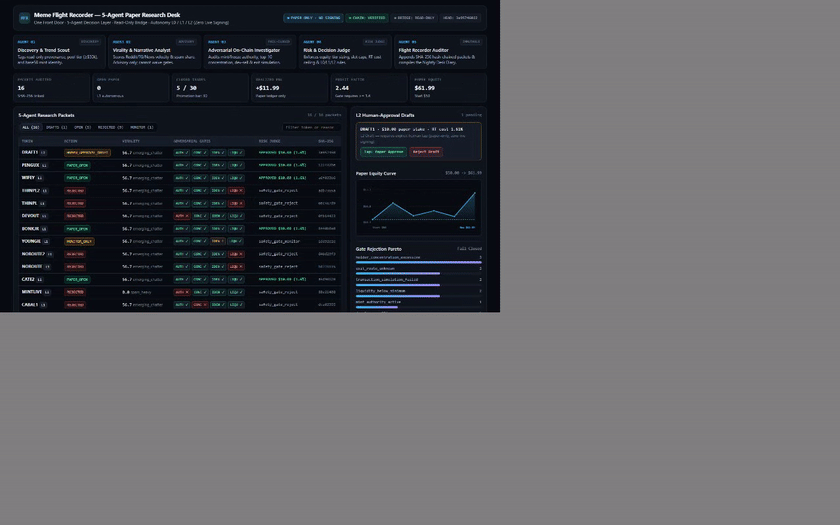
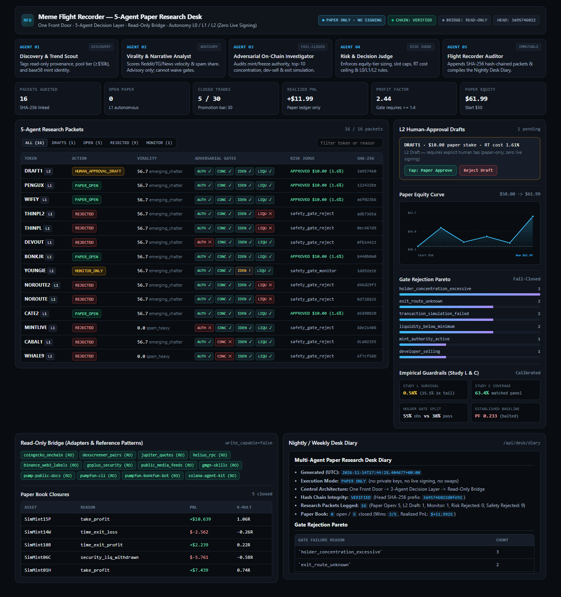
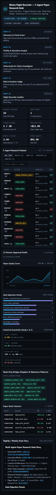
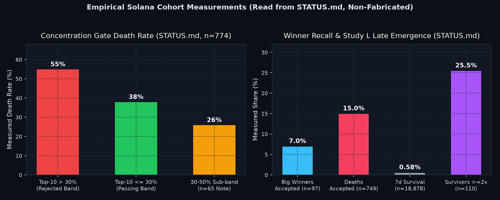
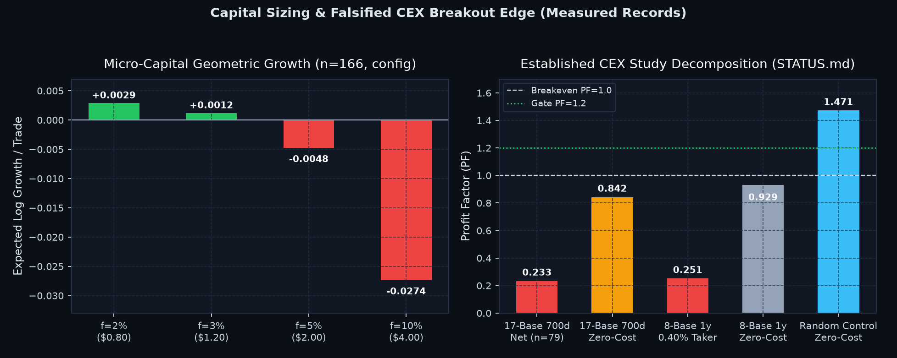
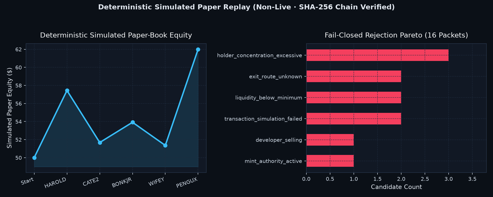
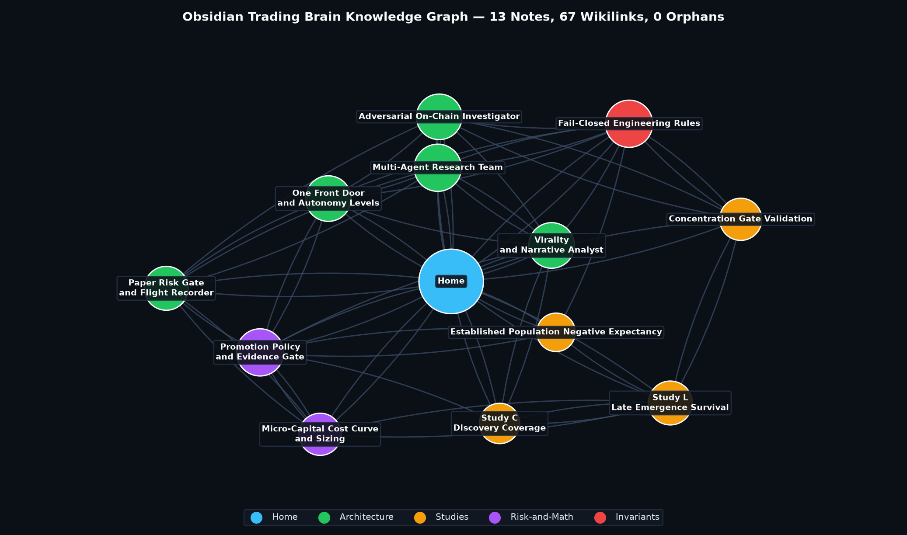
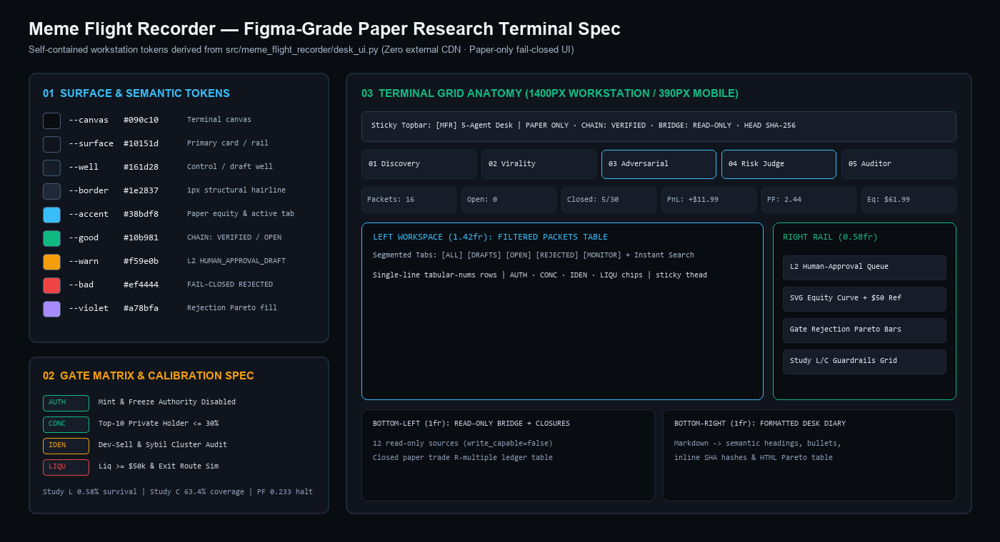

# Meme Flight Recorder — Paper-Only 5-Agent Crypto Research Desk

> **STRICTLY PAPER-ONLY RESEARCH INFRASTRUCTURE.** This repository records point-in-time market evidence, enforces fail-closed adversarial safety gates, runs deterministic paper & shadow simulations, and maintains a tamper-evident hash-chained SQLite journal. **It contains zero wallet signing, zero private-key handling, zero swaps, and zero live order routing.** All simulated replay curves reflect hypothetical paper executions with modeled fees and slippage—never live-money performance.

---

## Architecture: 5 Agents · 1 App · 1 Master Prompt

Built around an **Operator Desk-in-a-Box** architecture—combining a **One Front Door** operator console, a **5-Agent Decision Layer**, a **Read-Only Bridge**, and explicit **L0 / L1 / L2 Autonomy Guardrails** so nothing ever touches real capital:

```mermaid
flowchart LR
    OP["One Front Door\nFastAPI /desk UI & CLI"] --> PROMPT["1 Master Prompt\nprompts/desk_system_prompt.md"]
    BRIDGE["Read-Only Bridge (write_capable=False)\nCoinGecko · Jupiter · Helius · Public Media\nAdapter Patterns: gmgn-skills · pump-public-docs\npumpfun-cli · pumpfun-bonkfun-bot · solana-agent-kit"] --> A1

    subgraph DL["5-Agent Decision Layer (Fail-Closed)"]
        A1["1. Discovery & Trend Scout\nProvenance, $50k pool tier, base58 mint"] --> A2["2. Virality & Narrative Analyst\nReddit/TG/News velocity & spam filter\n(Strictly Advisory — Cannot Waive Gates)"]
        A2 --> A3["3. Adversarial On-Chain Investigator\nAuthority, top-10 concentration, dev-sell,\nliquidity & unsigned exit-route sim"]
        A3 --> A4["4. Risk & Decision Judge\nEquity-tier sizing, slot caps, RT cost limit\nAutonomy: L0 Observe / L1 Paper / L2 Human Draft"]
    end

    A4 --> A5["5. Flight Recorder & Journal Auditor\nSHA-256 Hash-Chained SQLite Journal\n& Nightly Desk Diary Generator"]
    A5 --> OP
    A5 --> VAULT["Obsidian Trading Brain\nvault/Home.md (13 notes, 0 orphans)"]
```



### The Five Specialized Agents (`src/meme_flight_recorder/research_team.py`)
1. **`DiscoveryTrendScout`** — Normalizes read-only provenance, enforces `$50k` minimum pool tier, validates exact Solana base58 mint identity, and emits structured `DiscoveryReport` signals.
2. **`ViralityNarrativeAnalyst`** — Aggregates public Reddit, Telegram, and crypto news velocity alongside narrative alignment and spam/bot ratios (`providers/media_feeds.py`, `social_intelligence.py`, `narratives.py`). **Strictly advisory**: high social heat cannot override any safety or risk gate.
3. **`AdversarialOnChainInvestigator`** — Runs fail-closed checks (`safety.py`, `vendor_labels.py`) across mint/freeze authority, vendor dev-sell/rug labels, top-10 private holder concentration (`>30%` hard reject on emerging Solana), pool liquidity minimums, and independent reverse-route exit simulation. Unknown critical fields fail closed (`REJECT`).
4. **`PaperRiskJudge` (`PaperRiskGate`)** — Applies micro-capital equity-tier sizing, max open position slots (`max_open_positions=2` under micro risk), daily/aggregate risk limits, round-trip fee thresholds (`max_round_trip_cost_pct`), and enforces explicit autonomy ceilings:
   - **`L0: Observe Only`** (`L0_observe_only`) — Records and scores only; cannot open paper positions.
   - **`L1: Paper Replay & Journal`** (`L1_paper_replay_and_journal`) — Opens/closes paper positions inside the deterministic paper book after clearing all safety & risk gates.
   - **`L2: Human-Approval Draft`** (`L2_human_approval_draft`) — Emits a `HumanApprovalDraft` requiring an explicit operator tap (`Tap: Paper Approve` / `Reject Draft`) before entering the paper ledger.
5. **`FlightRecorderAuditor`** — Appends every observation, rejection, L2 draft, and paper trade to the SHA-256 hash-chained SQLite journal (`journal.py`), verifies chain integrity (`verify_chain()`), and generates nightly/weekly Markdown Desk Diaries (`desk-diary`).

### One Desk App (`src/meme_flight_recorder/desk_ui.py`) & One Master Prompt (`prompts/desk_system_prompt.md`)
- **Unified Operator Console (`/desk`)**: Dark-slate responsive dashboard surfacing the 5-agent pipeline status, hash-chain verification badge, single-tap L2 Paper Approval queue, Gate Rejection Pareto, Paper Equity SVG curve, Read-Only Bridge provenance tags, paper book closures, and live Desk Diary viewer.
- **Single Master Prompt (`prompts/desk_system_prompt.md`)**: Codifies the complete 5-agent schema, hard invariants, Read-Only Bridge boundaries, and L0/L1/L2 paper-only contract.

---

## Read-Only Bridge & Protocol Adapter Patterns

`ReadOnlyBridge` enforces `write_capable=False` across all internal providers and documented ecosystem reference schemas:

| Source / Reference Pattern | Role in Meme Flight Recorder | Access Boundary |
|---|---|---|
| `CoinGeckoProvider` / `DexScreener` / `JupiterQuoteProvider` / `HeliusRpcProvider` | Pool discovery, OHLCV, reverse exit-route quotes, mint/freeze authority, top-10 accounts | Read-only HTTP / unsigned simulation |
| `MediaFeedCollector` (`providers/media_feeds.py`) & `vendor_labels.py` | Public RSS/Reddit/TG feeds & GoPlus/Binance Web3 risk labels | Read-only public feeds & risk tags |
| [`GMGNAI/gmgn-skills`](https://github.com/GMGNAI/gmgn-skills) | Smart-money tracking & holder concentration query schemas | Read-only telemetry pattern |
| [`pump-fun/pump-public-docs`](https://github.com/pump-fun/pump-public-docs) & [`chainstacklabs/pumpfun-cli`](https://github.com/chainstacklabs/pumpfun-cli) | Pump.fun bonding curve & PumpSwap AMM reserve/migration state schemas | Read-only curve & graduation math |
| [`chainstacklabs/pumpfun-bonkfun-bot`](https://github.com/chainstacklabs/pumpfun-bonkfun-bot) & [`sendaifun/solana-agent-kit`](https://github.com/sendaifun/solana-agent-kit) | Solana token analytics & CLI inspection conventions (signing interfaces strictly excluded) | Read-only analytics contract only |

---

## Visual Proof & Live Desk Walkthrough

> Captured from deterministic simulated paper replay (`scripts/generate_proof_charts.py`) and live headless Chromium + Playwright captures (`scripts/capture_desk_proof.py`) against the local FastAPI `/desk` server.

### Desk UI Walkthrough (Live Operator Console)


- Full-resolution video capture: [`docs/proof/desk_walkthrough.mp4`](docs/proof/desk_walkthrough.mp4)

### Desktop (`1440×900`) & Mobile (`390×844`) Desk UI Captures
| Desktop Operator Console | Mobile Responsive (`390×844`) |
|---|---|
|  |  |

### Empirical Research & Deterministic Paper Replay Charts
| Concentration Gate Validation (`n = 774`) | Micro-Capital Cost Curve & Established Population Study |
|---|---|
|  |  |

| Deterministic Simulated Paper Replay & Gate Funnel | Obsidian Trading Brain Graph (`13 nodes · 67 edges · 0 orphans`) |
|---|---|
|  |  |
| [](docs/proof/figma-design-spec.png) | Self-contained dark-terminal design system tokens (`--canvas` through `--violet`), 4-gate severity badges, and `1400px` / `390px` grid anatomy (`scripts/render_figma_spec.py`) |

---

## Empirical Findings Summary (Grounded in `STATUS.md` & `CLAUDE.md`)

1. **Study L — Late-Emergence Base-Rate (`18,878` pools):** Only **`110 / 18,878` (`0.58%`)** survived 7 days with `liq >= $50k` & `vol >= $10k`. Within that surviving cohort, `25.5%` reached `>=2x` and `12.7%` reached `>=5x`, whereas the 48h cohort (`n=32`) achieved **`0%`** `>=2x` survival.
2. **Study C — Discovery Coverage (`41` historical winners):** Current emerging scanners surfaced **`26 / 41` (`63.4%`)** of multi-day winners; the remaining miss fraction drove the `>= $50k` pool tier and 14d watchlist design.
3. **Adversarial Concentration Gate (`n = 774` Solana tokens):** Tokens with `top10_holder_pct > 30%` died at **`55%`**, compared with **`38%`** for `<= 30%`. Loosening the gate to `50%` increased winner recall by only `0% -> 7%` (`n=97`) while increasing deaths by **`15%`** (`n=749`).
4. **Established CEX Population (`17 bases × 700d`, `1,096,664` 15m bars):** Held-out breakout/retest trades (`n=79`) yielded **`-$0.0080/trade`** (Profit Factor **`0.233`** with costs; **`0.842`** zero-cost), establishing negative baseline expectancy—why live trading remains strictly gated off.
5. **Micro-Capital Fee Drag:** Reducing per-slot notional from `$10` (`5.44%` round-trip cost at `$50` equity) to `$30` (`1.81%` RT cost) raises historical Profit Factor from **`0.138`** to **`0.476`**, driving the explicit `max_round_trip_cost_pct` risk gate.

---

## Interconnected Obsidian Trading Brain (`vault/`)

Open `vault/` directly in Obsidian (pre-configured with `vault/.obsidian/graph.json`):
- **Entry Point:** [`vault/Home.md`](vault/Home.md)
- **Topology:** `13` interlinked Markdown notes, `67` `[[wikilinks]]`, **`0` orphan notes**, **`0` broken links** (enforced automatically in CI via `tests/test_research_team.py`).
- **Structure:** `Architecture/` (5 notes), `Studies/` (4 empirical research notes), `Risk-and-Math/` (2 notes), and `Invariants/` (1 engineering rules note).

---

## Tools, Skills, AI Agents & Quant Stack

| Layer | Technologies & Modules |
|---|---|
| **5-Agent Orchestration** | `ResearchTeamCoordinator`, `DiscoveryTrendScout`, `ViralityNarrativeAnalyst`, `AdversarialOnChainInvestigator`, `PaperRiskGate`, `FlightRecorderAuditor` (`src/meme_flight_recorder/research_team.py`) |
| **Desk UI & API** | FastAPI, Pydantic v2, Uvicorn, self-contained HTML5/CSS/JS/SVG Desk UI (`src/meme_flight_recorder/desk_ui.py`, `api.py`, `cli.py`) |
| **Fail-Closed Safety & Risk** | `safety.py`, `vendor_labels.py`, `risk.py`, `costs.py`, `paper.py`, `readiness.py` |
| **Immutable Audit & Vault** | SQLite WAL + SHA-256 hash-chained `FlightJournal` (`journal.py`), Obsidian Markdown Graph (`vault/`) |
| **Read-Only Market & Social Data** | `CoinGeckoProvider`, `JupiterQuoteProvider`, `HeliusRpcProvider`, `MediaFeedCollector` (`providers/media_feeds.py`), `ccxt` public OHLCV, Freqtrade dry-run (`integrations/freqtrade/`) |
| **Verification & Visual Proof** | `pytest`, `ruff`, Playwright + headless Chromium, `matplotlib`, `networkx`, `Pillow`, `ffmpeg` |

---

## Quick Start

Requires Python 3.12+.

```bash
cp .env.example .env
python -m venv .venv
source .venv/bin/activate        # Windows: .venv\Scripts\activate
python -m pip install -e ".[dev]"
pytest -q
ruff check src tests scripts
```

Launch the FastAPI server and open the **5-Agent Paper Research Desk**:

```bash
uvicorn meme_flight_recorder.api:app --host 127.0.0.1 --port 8000
```

- **Desk UI (One Front Door):** `http://127.0.0.1:8000/desk`
- **OpenAPI Docs:** `http://127.0.0.1:8000/docs`
- **Desk State & Diary APIs:** `GET /api/desk/state`, `GET /api/desk/diary`, `POST /api/desk/evaluate`, `POST /api/desk/decision`
- **CLI Nightly Desk Diary:** `python -m meme_flight_recorder.cli desk-diary --out docs/proof/sample_desk_diary.md`

### Key Environment Variables (`config.py`)
- `MFR_CONFIG`: Path to TOML configuration (defaults to `config/default.toml`).
- `MFR_DATABASE_PATH`: Path to the append-only SQLite journal (defaults to `data/flight_recorder.db`).
- `MFR_STARTING_EQUITY_USD`: Simulated starting paper equity in USD.

---

## Documentation & Proof

- **[Engineering Case Study](docs/CASE_STUDY.md)** — Full empirical analysis, failure modes, mathematical cost derivation, and multi-agent architecture decisions.
- **[Proof of Work & Verification Log](docs/PROOF_OF_WORK.md)** — Verbatim test, lint, hash-chain verification, chart, and headless UI capture logs.
- **[Master Desk Prompt](prompts/desk_system_prompt.md)** — Complete 5-agent schema and paper-only autonomy contract.
- **[Status Ledger](STATUS.md)** & **[Mandate Mapping](docs/MANDATE_MAPPING.md)** — Ground-truth empirical research record.
