# Engineering & Quantitative Case Study — Meme Flight Recorder

> **Strict Invariant:** Paper-only empirical meme-coin research desk. Nothing in this repository contains private keys, seed phrases, transaction signing, or live swap execution (`tests/test_no_live_execution.py`). All simulated paper-replay numbers are explicitly labeled non-live.

---

## 1. Problem Statement & Market Microstructure Reality

Meme-coin launchpads (Pump.fun, PumpSwap, Raydium, Meteora) exhibit extreme adverse selection, short token half-lives, and adversarial information surfaces:

1. **Extreme Attrition & Fat-Tailed Payoffs:** Across `18,878` distinct priced Solana mints observed `>= 7` days in `STATUS.md` (**Study L**), only `110` (`0.58%`) remained quoted on any venue with `>= $5,000` liquidity. Yet among those rare survivors, `25.5%` traded `>= 2x` and `12.7%` traded `>= 5x` their initial observation price (versus `0%` at `>= 2x` in the 48-hour arm, `n = 32`).
2. **Ticker Impersonation & Social Sybils:** Five distinct `CATE` mints and four `SAOF` mints appeared in a single night. Any social pipeline that resolves cashtags (`$CATE`) to addresses or counts forwarded relays as independent conviction manufactures false signals.
3. **Illiquid Gap Risk & Fixed-Fee Distortion:** In historical replay, a collapsing token fell **1,700× past its stop inside a single candle** (`docs/MANDATE_MAPPING.md`). Simultaneously, fixed per-transaction Solana network costs distort micro-bankroll economics: on identical entries, a `$0.80` position suffers `5.44%` round-trip cost (`PF = 0.138`) compared to `1.81%` at `$10.00` (`PF = 0.476`).
4. **Absent Is Not Zero:** Missing RPC or quote fields originally caused provider outages to masquerade as risk rejections (`13/56` winners misclassified) or inflated EV estimates (`+$130,273/$` off a `$0.00`-liquidity pool).

---

## 2. Architecture: 5 Agents · 1 Desk App · 1 Master Prompt

Building on the fail-closed core (`SafetyEngine`, `RiskEngine`, `FlightRecorder`, `PaperBroker`), the research desk implements an explicit control plane following the **One Front Door + Decision Layer + Read-Only Bridge + Autonomy Levels** pattern:

```mermaid
flowchart LR
    subgraph RO["Read-Only Bridge (write_capable=false, signing_capable=false)"]
        CG["CoinGecko Onchain\n(3-page trending)"]
        DS["DexScreener & Jupiter\n(Liquidity & Reverse Quotes)"]
        HL["Helius & GoPlus & BW3\n(Authority, Top10, DevSell)"]
        MF["Public Media Feeds\n(Reddit Atom, TG Preview, GNews)"]
    end

    subgraph DL["5-Agent Decision Layer (src/meme_flight_recorder/research_team.py)"]
        A1["Agent 1: Discovery & Trend Scout\n(Pool tier & base58 mint ID)"]
        A2["Agent 2: Virality & Narrative Analyst\n(Advisory only; spam & relay dedup)"]
        A3["Agent 3: Adversarial On-Chain Investigator\n(Fail-closed safety + vendor overlay)"]
        A4["Agent 4: Risk & Decision Judge\n(Equity tier, slot caps, RT cost ceiling)"]
        A5["Agent 5: Flight Recorder Auditor\n(SHA-256 chain + Desk Diary)"]
        A1 --> A2 --> A3 --> A4 --> A5
    end

    subgraph FD["One Front Door (1 App · 1 Prompt)"]
        UI["FastAPI Desk UI (/desk)\n+ Single-Tap L2 Paper Approve"]
        CLI["CLI (meme-recorder desk-diary)"]
        PR["prompts/desk_system_prompt.md"]
    end

    RO --> A1
    RO --> A2
    RO --> A3
    A4 -->|L0 Observe| JRN["SQLite FlightRecorder\n(Hash-Chained Append-Only)"]
    A4 -->|L1 Paper Replay| PB["PaperBroker\n(Non-Live)"]
    A4 -->|L2 Draft| UI
    A5 --> JRN
    JRN --> UI
    JRN --> CLI
```

### Key Architectural Invariants
- **Strict Sequential Veto:** Agent 2 (`ViralityNarrativeAnalyst`) sets `advisory_only = True` and **cannot** waive Agent 3 (`AdversarialOnChainInvestigator`) or Agent 4 (`PaperRiskJudge`).
- **Overlay, Never Overwrite:** `VendorLabelIndex` (`vendor_labels.py`) populates `developer_selling` and `top10_private_holder_pct` **only** when direct RPC evidence is `None`, and preserves raw vendor labels for re-derivation.
- **Autonomy Levels (`AutonomyLevel`):**
  - `L0_observe_only`: Evaluates and journals research packets without opening paper positions.
  - `L1_paper_replay_and_journal`: Permits deterministic simulated paper positions in `PaperBroker`.
  - `L2_human_approval_draft`: Emits an unsigned `HumanApprovalDraft` (`requires_human_confirmation=True`, `execution_blocked=True`, `signing_capable=False`) for single-tap paper review in `/desk`.
- **Cryptographic Tamper Evidence:** Every event hashes `SHA256(previous_hash | observed_at | event_type | entity_id | canonical_payload_json)` from `GENESIS`. `PaperBroker` reconstructs open positions solely by replaying `paper_position_opened` and `paper_position_closed` rows.

---

## 3. Empirical Findings & Falsified Hypotheses (`STATUS.md`)

Rather than tuning thresholds post hoc to manufacture backtest profits, every study pre-commits its decision rule in `docs/superpowers/specs/` before fetching data:

| Study / Gate | Population & Sample | Measured Outcome | Decision |
|---|---|---|---|
| **Concentration Gate** | `n = 774` priced Solana tokens | `55%` death rate above `30%` top-10 vs `38%` below `30%` (`26%` in `30–50%`, `n=65`) | **Validated** on death rate; gate retained |
| **Developer Distribution Band** | `n = 871` Solana mints | `7%` death when fully exited (`>= 50%`) vs `28%` at `0%` sold; active selling `[1%, 50%)` rejects | **Fixed** inverted boolean flag to band |
| **Study L (Late Emergence)** | `18,878` `>= 7d` mints vs `48h` (`n = 32`) | `110` (`0.58%`) survive `>= $5k`; `25.5% >= 2x`, `12.7% >= 5x` vs `0%` at `48h` | **Supports** 7-day hold horizon (descriptive) |
| **Study C (Discovery Coverage)** | `41` qualified movers (`>=$50k`, `>=2d`) | `26 / 41` (**63.4%**) present in journal | **Widened** movers feed to 3 pages |
| **Established CEX Study (8-base 1y)** | `279,359` 15m bars (Binance) | Held-out (`n=33`): PF `0.286`; zero-cost PF `1.017` vs random control PF `1.471` | **Unproven** — no gross breakout edge |
| **Established Widening (17-base 700d)** | `1,096,664` bars across uptrend & downtrend | Held-out (`n=79`): `-$0.0080/trade`, PF `0.233`; zero-cost PF `0.842` (`< [0.9, 1.1]`) | **LINE CLOSED** permanently |
| **Winner Recall Post-Fix** | `n = 97` winners, `n = 749` deaths | `7%` winner acceptance vs `15%` death acceptance (`100` concentration rejects) | Gates buy survival, not return |

---

## 4. Micro-Capital Sizing & Cost-Curve Mathematics

In `costs.py`, round-trip cost splits fixed per-leg network costs from proportional DEX fees and quoted Jupiter impact:

$$\text{RT\_Pct}(p) = \frac{2 \cdot c_{\text{fixed}}}{p} + 2 \cdot f_{\text{dex}} + i_{\text{entry}} + i_{\text{exit}}$$

Solving $\text{RT\_Pct}(p) \le \tau_{\max}$ yields the closed-form viability floor (`minimum_viable_position_usd`), measured at `$0.37` for a `10%` ceiling. However, geometric log-growth optimization over the fat-tailed deep-pool distribution (`n = 166`, median outcome `0.001`) reveals severe over-Kelly decay at `10%` equity sizing:

- `f = 2%`: `+0.0029` expected log growth / trade
- `f = 3%`: `+0.0012` expected log growth / trade
- `f = 5%`: `-0.0048` expected log growth / trade
- `f = 10%`: `-0.0274` expected log growth / trade (`~75%` decay over 50 trades)

At the operator's `$50` bankroll / `$10` slot setting (`20%` equity, `1.81%` RT cost vs `5.44%` at `$0.80`), cost efficiency improves dramatically (`PF 0.138 -> 0.476`), at the explicit trade-off of `5` concurrent shots toward a `p ≈ 5.8%` tail requiring `~50` attempts.

---

## 5. Limitations & Promotion Governance

1. **No Live Profitability Claim:** Observed live-feed forward paper closures in `STATUS.md` (`3 of 30` closed at the time of the handoff) opened on `2026-08-15` and closed with `0%` win rate (`-$2.21`, `security_liquidity_withdrawn`), confirming that the system is an honest measurement instrument rather than a profitable bot.
2. **Binding Promotion Policy (`2026-08-22-promotion-policy.md`):** Live readiness cannot be considered before `>= 30` completed forward paper trades, positive net expectancy after all costs, `PF > 1.2`, no single trade `> 1/3` of total profit, **and** at least one new-signal study (`M1` media velocity or `W1` whale entry) passing its pre-registered held-out bar.
3. **Obsidian Trading Brain (`vault/`):** All 13 interconnected notes link directly to source modules and studies with zero orphans (`VaultIntegrityTests` enforces graph connectivity in CI).
